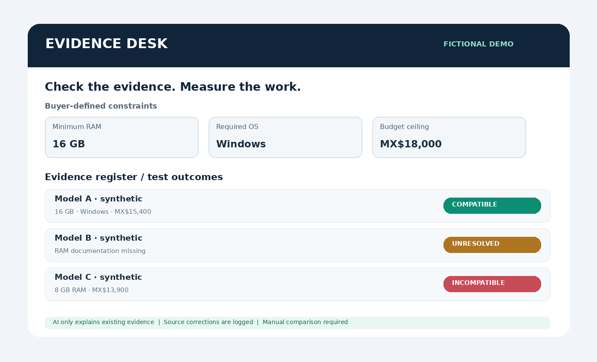
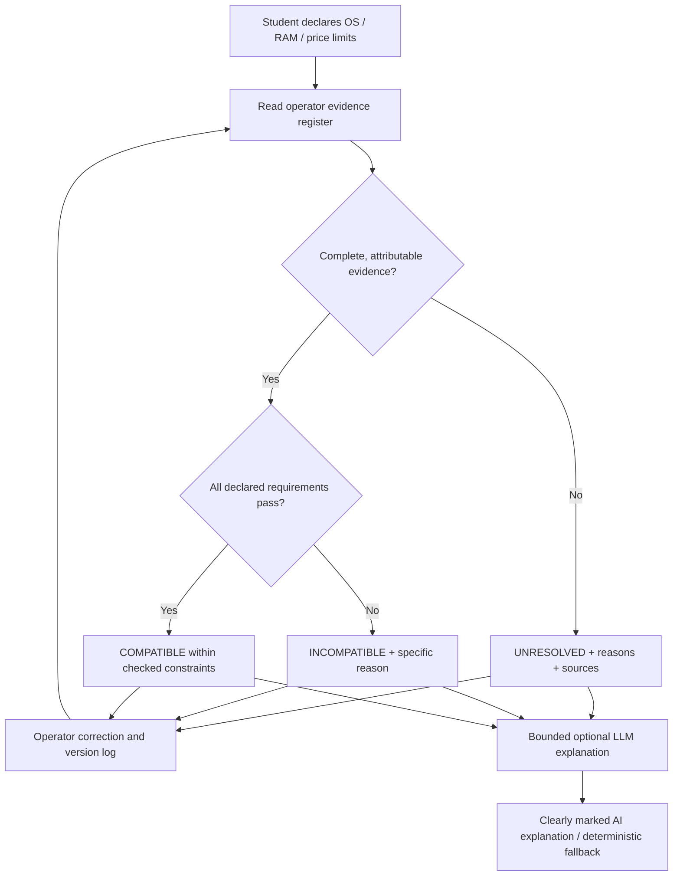
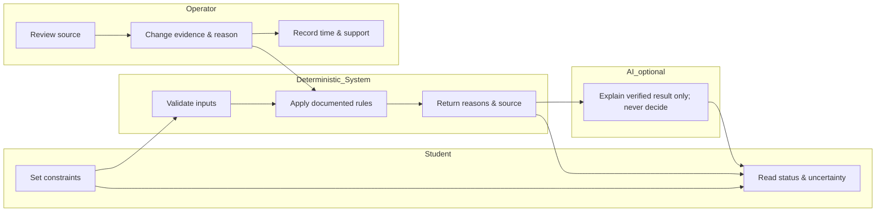

# PACKET — Week 10 | Sofía López | OPERATOR

**Status:** Pre-implementation plan. Hypotheses, demo records, and planned tests are not claims of validation.

## 1. Problem in my words
A student can receive seemingly definitive laptop-compatibility advice without knowing whether its specifications are current or verifiable. As OPERATOR, I need to test the recurring work of checking sources, correcting errors, handling unknowns, and supporting users. If a maintained manual checklist is equally useful, extra technology should not survive.

## 2. Exact user
A Mexican university student buying a laptop for a particular course/software requirement; secondary operator: the person responsible for updating and auditing a small documented laptop evidence register. The app is a **fictional educational demo**, with synthetic product records and no real student data.

## 3. Success definition before the module closes
A public working slice lets an operator (a) inspect and correct a small evidence register, (b) recompute deterministic compatibility classifications for student-declared RAM/OS/price constraints, (c) see compatible/incompatible/unresolved with source references and limits, (d) record manual-checklist and checker work durations for the same case, (e) export the register and activity record, and (f) view an explicitly labeled, bounded LLM explanation or a safe no-AI fallback. Unit economics remain unvalidated. A mechanical bug is documented, fixed, tested, and redeployed; a synthetic persona identifies the worst confusion and one focused correction is made.

## 4. Image-generated mockup

## 5. Flow (Mermaid)

## 6. Swimlane (Mermaid)

## 7. Global benchmark line
**Which? (UK)** demonstrates independently justified consumer product assessments; my narrower Mexican student slice exposes the maintenance/correction burden behind evidence-based laptop compatibility. **Zalando (Germany)** shows a different category-specific product mismatch approach, but its reported size-and-fit impact cannot be transferred to laptop compatibility.

## 8. Three-year long view (light charter; hypothetical)
If a narrow source-backed checker proves useful and affordable, a small independent team could expand to selected educational hardware categories with published audit standards. Students would still decide their budgets and preferences while unresolved claims remained visibly unresolved. A service would expand only when repeated comparison tests prove more benefit than a maintained public checklist and credible non-conflicted funding exists.

## 9. Scope cut
**Keep:** fictional laptop evidence rows; source labels; user-declared RAM, OS and price; verified/unresolved classification; one-at-a-time evidence correction; before/after change log; manual-vs-tool timer records; local export; bounded optional explanatory LLM with deterministic fallback. **Defer:** real manufacturer integrations, real SKU catalog, institutional accounts, automatic spec crawling, production analytics. **Kill:** store, seller-side recommender, affiliate links, automatic purchasing, happiness prediction, user ranking, inferred constraints, real personal data, unverified specs, AI-generated classifications, claims of actual 10:1.

## 10. Architecture + stack
| Layer | Choice | Rationale |
| --- | --- | --- |
| UI | Static HTML/CSS and browser JavaScript | Lightweight on Vercel; mobile responsive |
| Constraints | User-selected RAM, OS and price ceiling | Buyer controls; price data is **fictional**, not live |
| Evidence | Fixed simulated register, local edits in session and CSV/JSON export | Supports correction/maintenance comparison; no real data |
| Rule engine | Pure deterministic JS | Reproducible, testable; unknown != incompatible |
| LLM | Optional serverless `/api/explain` endpoint via Vercel environment variable | Explains supplied classifications only; never decides |
| Third Dragon input | Fictional laptop **price data** | Used as explicit price ceiling constraint; never seller ranking |
| Storage | Browser localStorage for **fictional demo data only** | No personal information, no login needed; resettable |
| Tests | Node built-in test runner | No paid dependency |
| Hosting | Vercel | Two actual deploys required before submission |

**Dragon Stack:** LLM explanation + student-declared constraint data + fictional price data. This is a minimal research slice, not live shopping intelligence.

## 11. Test plan and acceptance
| ID | Scenario | Expected result |
| --- | --- | --- |
| T01 | RAM above documented specification | INCOMPATIBLE |
| T02 | OS explicitly unsupported | INCOMPATIBLE |
| T03 | Evidence missing/conflicting for a required field | UNRESOLVED; no verified label |
| T04 | All declared constraints met | COMPATIBLE **within listed constraints**, not purchase advice |
| T05 | Price over declared ceiling | INCOMPATIBLE to declared constraint; no budget inference |
| T06 | Operator corrects evidence | status recomputes and history records reason/time |
| T07 | Bad input: unsupported OS, RAM out of bounds, oversized notes | blocked with visible error |
| T08 | Server AI unavailable | honest deterministic explanation; no fake AI output |
| T09 | Export then open as standalone data | valid JSON or CSV evidence and activity log |
| T10 | Checklist comparison | same scenarios, explicit time/support fields, no invented savings |
| T11 | Phone width | forms readable and interactive on mobile |
| T12 | Persona | new chat, screenshots in order, worst confusion -> one copy/UX fix |

## 12. Blueprint condition mapping
1. **Traceable/correctable evidence:** every row has a source label, status can be unresolved, operator revisions logged.
2. **SHADOW — Buyer autonomy:** explicit constraints; no system-initiated purchase, budget increases, emotional persuasion.
3. **Visible uncertainty:** no-match/unresolved; coverage banner; no claim of complete market; synthetic prices.
4. **Operational value:** measure manual vs checker; compare ongoing corrections and support; no unproved impact claims.
5. **Independent governance:** no affiliate or vendor payments, no real personal data, no sponsor access; funding and ongoing cost remain unvalidated.

## 13. Security floor before build
No committed secrets; API key only Vercel environment variables; no personal data stored; no Supabase tables/auth necessary because all records are explicitly fictional. All inputs validated with limits and allowlists. LLM receives only fictional constrained values. API output marked AI-generated and cannot overwrite results. Any later production use with personal data would require authentication and authorization/RLS as appropriate.

## 14. Commit/deploy and session-close plan
C1 `docs: define packet and architecture before code`; C2 `feat: implement deterministic evidence checker`; C3 `feat: add operator evidence corrections and activity export`; C4 `feat: add bounded AI explanation and fallback`; **Deploy 1**; C5 `test: add mechanical cases and fix reproduced bug`; C6 `fix: address worst persona confusion`; **Deploy 2**. After each work session update `docs/DECISIONS.md`, record next action, commit and push. These commits and deploys are plans until performed, not submitted evidence.

## 15. Open validation slots
- Mechanical test actual run, observed bug, fix commit, redeploy URL: **PENDING**.
- Persona identity/scenario, screenshot-by-screenshot log, confusion, specific fix: **PENDING NEW CHAT**.
- Actual Vercel URLs (two deploys), GitHub commit hashes: **PENDING**.
- User time studies and repeatability: **NOT VALIDATED**.
